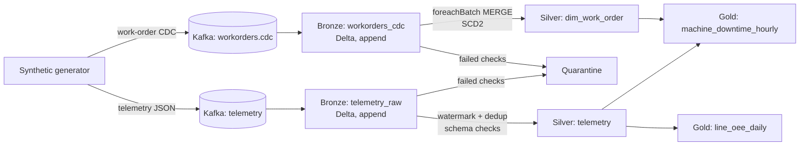

# plant-telemetry-lakehouse

[](https://github.com/navyaajs-web/plant-telemetry-lakehouse/actions/workflows/ci.yml)


A streaming lakehouse for a fictional manufacturer, **Larkfield Components**. Machine telemetry and work-order change events arrive on Kafka. Spark Structured Streaming lands them in Delta Lake bronze, silver and gold layers. Work orders are merged from CDC events into a slowly changing dimension, and plant-level downtime and OEE metrics are published in gold.

Everything runs on a laptop with Docker. All data is synthetic.

## Problem
Plant systems emit two kinds of data:
- High-volume sensor readings, which arrive late, duplicated and occasionally malformed.
- A trickle of insert, update and delete events from the work-order system.

Analysts need the following, without reprocessing everything each night:
- Per-machine and per-line downtime, with work-order context.
- A history of how work orders changed.

## Architecture


## Run it in three commands
```bash
make up        # starts Kafka (Redpanda) and a Spark container
make demo      # generates 10 minutes of synthetic plant data and runs all streams
make query     # prints gold tables
```
`make down` stops everything. Requires Docker and about 4 GB of RAM.

## What is inside
| Path | What it does |
|---|---|
| `src/plant_telemetry/generator/` | Synthetic telemetry and CDC producer, with configurable late, duplicate and bad-record rates |
| `src/plant_telemetry/pipelines/bronze.py` | Kafka → Delta append with ingestion metadata |
| `src/plant_telemetry/pipelines/silver_telemetry.py` | Parse, validate, watermark, dedup on `(machine_id, event_ts, seq)`, quarantine |
| `src/plant_telemetry/pipelines/silver_workorders.py` | `foreachBatch` MERGE that applies CDC as SCD Type 2, idempotent on replay |
| `src/plant_telemetry/pipelines/gold.py` | Hourly downtime and daily OEE aggregates |
| `src/plant_telemetry/pipelines/run.py` | Runs every layer, once (`availableNow`) or continuously |
| `src/plant_telemetry/common/` | Spark session, schemas, config |
| `tests/` | pytest with a local SparkSession: dedup, late data, SCD2 merge, replay idempotency |

## Tests
```bash
make setup     # pip install -e ".[dev]"
make test
```
Tests need Java 17+ but no Kafka or Docker. The SCD2 MERGE tests use real Delta tables; Spark resolves the Delta jar from Maven on the first run, and if it cannot (offline), those tests are skipped while the rest still run. CI runs `ruff` and `pytest` on every push, with Delta required.

## What this proves
- I can design an idempotent streaming pipeline (watermarks, dedup keys, replay-safe MERGE).
- I can apply CDC into a Delta dimension with history.
- I can separate bad records without stopping the stream.
- I can test streaming logic locally.

## Running on Databricks (optional)
The pipeline modules run unchanged as Databricks jobs. `docs/databricks.md` covers:
- Pointing the checkpoints and tables at Unity Catalog volumes and tables.
- Swapping Redpanda for a managed Kafka endpoint.

## Limitations
- Single-node Spark, so throughput numbers from this repo say nothing about production scale.
- Exactly-once holds for the Delta sink via checkpointing. The generator itself is at-least-once by design, to exercise dedup.
- No Unity Catalog permissions model. See `databricks-lakeflow-bundle` for that.

## About the author
Built by Navya Sindhu, Senior Data Engineer. [LinkedIn](https://www.linkedin.com/in/navyaajs/). This is a personal project with synthetic data. It contains no employer or client code, schemas or data.
